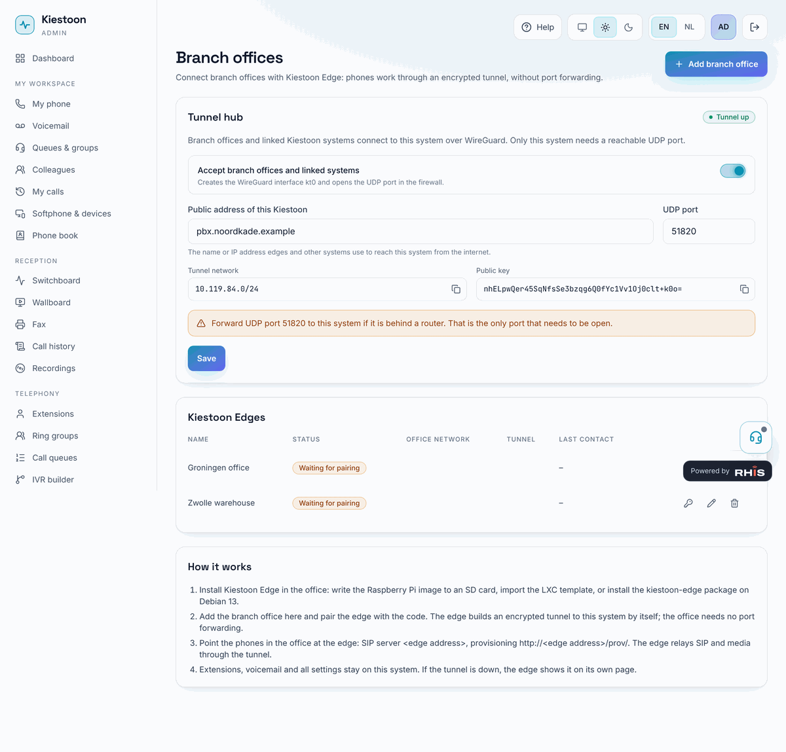

<p align="center"></p>

<h1 align="center">Kiestoon</h1>

<p align="center">
  <b>The open source phone system for small and growing businesses.</b><br>
  One Debian 13 server or Proxmox container, a modern web portal, and everything from extensions to branch offices.<br>
  English by default, fully translated into Dutch. Powered by RHIS.
</p>

<p align="center">
  <a href="https://rhisijmuiden.github.io/Kiestoon/"><b>📖 Manual</b></a> ·
  <a href="https://rhisijmuiden.github.io/Kiestoon/nl/">Handleiding (Nederlands)</a> ·
  <a href="README.nl.md">README in het Nederlands</a> ·
  <a href="https://github.com/rhisijmuiden/Kiestoon/releases">Releases</a> ·
  <a href="ROADMAP.md">Roadmap</a>
</p>

<p align="center"></p>

Kiestoon is a single-tenant PBX built on **Asterisk 22 LTS**, with a Go backend and a React portal. You install it in
minutes, set it up in the browser, and the people in the office manage their own phone in the user portal. Every
page of the portal has a **Help** button that opens the matching page of the [manual](https://rhisijmuiden.github.io/Kiestoon/), in your language.

> Status: **v0.6, testing channel**. Everything of a small-business PBX, plus branch offices, linked systems and high
> availability. See the [roadmap](ROADMAP.md).

## What you can do with it

<table>
<tr>
<td width="50%" valign="top">

### 🧭 Visual IVR builder
Draw the call flow on a canvas: menus, time conditions, queues and voicemail, connected by dragging lines. Test a
menu by letting Kiestoon call you. [Read more](https://rhisijmuiden.github.io/Kiestoon/ivr/)

</td>
<td width="50%" valign="top">


</td>
</tr>
<tr>
<td valign="top">


</td>
<td valign="top">

### 🤝 Drag-and-drop transfer
Every employee sees who is available, and transfers a call by dragging it onto a colleague, ring group or queue:
directly or after asking first. Reception has a full switchboard and a wallboard.
[Read more](https://rhisijmuiden.github.io/Kiestoon/portal/#colleagues-and-drag-and-drop-transfer)

</td>
</tr>
<tr>
<td valign="top">

### ☎️ Phones that set themselves up
Yealink, Snom, Fanvil, Grandstream, Gigaset, Poly, Htek, Akuvox and Cisco phones are provisioned automatically: plug in, link to an
extension, done. A visual key editor with expansion modules, key templates and intercom.
[Read more](https://rhisijmuiden.github.io/Kiestoon/phones/)

</td>
<td valign="top">


</td>
</tr>
<tr>
<td valign="top">



</td>
<td valign="top">

### 🏢 Branch offices, linked systems and failover
A Raspberry Pi with Kiestoon Edge connects a branch office through a WireGuard tunnel, without port forwarding.
Link Kiestoon systems in different countries with one phone book and follow-the-sun routing, and run an
active/passive pair that takes over within seconds. [Read more](https://rhisijmuiden.github.io/Kiestoon/edge/)

</td>
</tr>
</table>

### Everything else

| | |
| --- | --- |
| **Telephony** | Extensions, ring groups, call queues with agents and wallboard, time conditions with Dutch public holidays, conference rooms, call parking, feature codes, voicemail to e-mail, fax to e-mail and PDF, call recording |
| **Providers** | Trunk templates with step-by-step guides (Voys and others), inbound and outbound routes, number plan wizard, emergency calls that always work |
| **Speech** | Text-to-speech (Piper) for menus and voicemail transcription (Whisper), on the server itself: no audio leaves the phone system |
| **User portal** | Do not disturb, forward to mobile, follow me, own hours, voicemail with greetings, queue sign-in, call history, browser softphone, QR code for SIP apps |
| **Windows softphone** | Tray app with contacts, presence, queues, headset buttons (Jabra, Poly, EPOS), `tel:` links and self-update |
| **Security** | Roles, MFA, passkeys, single sign-on (Entra ID, Google, Keycloak, authentik, OIDC, SAML), nftables firewall with safe mode, fail2ban, geo-blocking, toll-fraud protection, audit log |
| **System** | Let's Encrypt with Caddy or your own reverse proxy, encrypted backups (FTP, FTPS, SFTP, SCP, S3, WebDAV, SMB, OneDrive) with full and incremental runs and restore, own SMTP server with OAuth2, REST API, webhooks, Prometheus metrics, updates from the portal with a production and a testing channel |

## All features

Every part of Kiestoon with a screenshot from the real app (light or dark, following your GitHub theme). Click a picture for its chapter in the [manual](https://rhisijmuiden.github.io/Kiestoon/features/).

<!-- features:start -->

#### Telephony

<table>
<tr>
<td width="50%" valign="top"><a href="https://rhisijmuiden.github.io/Kiestoon/"><picture><source media="(prefers-color-scheme: dark)" srcset="https://rhisijmuiden.github.io/Kiestoon/assets/screenshots/en/dark/dashboard.png"></picture></a><br><b>Live dashboard</b><br>Calls in progress, registered phones, trunks and queues at a glance.</td>
<td width="50%" valign="top"><a href="https://rhisijmuiden.github.io/Kiestoon/extensions/"><picture><source media="(prefers-color-scheme: dark)" srcset="https://rhisijmuiden.github.io/Kiestoon/assets/screenshots/en/dark/extensions.png"></picture></a><br><b>Extensions</b><br>One page per extension: phones, voicemail, forwarding, recording and the linked user.</td>
</tr>
<tr>
<td width="50%" valign="top"><a href="https://rhisijmuiden.github.io/Kiestoon/ring-groups/"><picture><source media="(prefers-color-scheme: dark)" srcset="https://rhisijmuiden.github.io/Kiestoon/assets/screenshots/en/dark/ring-groups.png"></picture></a><br><b>Ring groups</b><br>Ring several phones at once or one after the other, with a fallback when nobody answers.</td>
<td width="50%" valign="top"><a href="https://rhisijmuiden.github.io/Kiestoon/queues/"><picture><source media="(prefers-color-scheme: dark)" srcset="https://rhisijmuiden.github.io/Kiestoon/assets/screenshots/en/dark/queues.png"></picture></a><br><b>Call queues</b><br>Agents, strategies, hold music, position announcements and a callback instead of waiting.</td>
</tr>
<tr>
<td width="50%" valign="top"><a href="https://rhisijmuiden.github.io/Kiestoon/ivr/"><picture><source media="(prefers-color-scheme: dark)" srcset="https://rhisijmuiden.github.io/Kiestoon/assets/screenshots/en/dark/ivr-canvas.png"></picture></a><br><b>Visual IVR builder</b><br>Draw the call flow on a canvas and connect the blocks by dragging lines.</td>
<td width="50%" valign="top"><a href="https://rhisijmuiden.github.io/Kiestoon/ivr/"><picture><source media="(prefers-color-scheme: dark)" srcset="https://rhisijmuiden.github.io/Kiestoon/assets/screenshots/en/dark/ivr-speech.png"></picture></a><br><b>Spoken menus and speech input</b><br>Type the text of a menu and let it be spoken; callers can also say what they want.</td>
</tr>
<tr>
<td width="50%" valign="top"><a href="https://rhisijmuiden.github.io/Kiestoon/time-conditions/"><picture><source media="(prefers-color-scheme: dark)" srcset="https://rhisijmuiden.github.io/Kiestoon/assets/screenshots/en/dark/time-conditions.png"></picture></a><br><b>Time conditions and holidays</b><br>Office hours per route, with Dutch public holidays filled in for you.</td>
<td width="50%" valign="top"><a href="https://rhisijmuiden.github.io/Kiestoon/conferences/"><picture><source media="(prefers-color-scheme: dark)" srcset="https://rhisijmuiden.github.io/Kiestoon/assets/screenshots/en/dark/conferences.png"></picture></a><br><b>Conference rooms</b><br>Dial-in rooms with a PIN, a moderator and an optional recording.</td>
</tr>
<tr>
<td width="50%" valign="top"><a href="https://rhisijmuiden.github.io/Kiestoon/prompts/"><picture><source media="(prefers-color-scheme: dark)" srcset="https://rhisijmuiden.github.io/Kiestoon/assets/screenshots/en/dark/voice-picker.png"></picture></a><br><b>Voice prompts and ElevenLabs voices</b><br>Record, upload or generate prompts with a local voice or an ElevenLabs voice.</td>
<td width="50%" valign="top"><a href="https://rhisijmuiden.github.io/Kiestoon/fax/"><picture><source media="(prefers-color-scheme: dark)" srcset="https://rhisijmuiden.github.io/Kiestoon/assets/screenshots/en/dark/fax.png"></picture></a><br><b>Voicemail and fax to e-mail</b><br>Voicemail with transcription and incoming faxes as PDF in your mailbox.</td>
</tr>
<tr>
<td width="50%" valign="top"><a href="https://rhisijmuiden.github.io/Kiestoon/call-journey/"><picture><source media="(prefers-color-scheme: dark)" srcset="https://rhisijmuiden.github.io/Kiestoon/assets/screenshots/en/dark/call-journey.png"></picture></a><br><b>Call history and call journey</b><br>Search every call and see its route step by step: menu, queue, who answered.</td>
<td width="50%" valign="top"><a href="https://rhisijmuiden.github.io/Kiestoon/ai/"><picture><source media="(prefers-color-scheme: dark)" srcset="https://rhisijmuiden.github.io/Kiestoon/assets/screenshots/en/dark/recording-ai.png"></picture></a><br><b>Recordings with AI summaries</b><br>Listen back, read the transcript and a short summary, locally or with Claude.</td>
</tr>
<tr>
<td width="50%" valign="top"><a href="https://rhisijmuiden.github.io/Kiestoon/call-quality/"><picture><source media="(prefers-color-scheme: dark)" srcset="https://rhisijmuiden.github.io/Kiestoon/assets/screenshots/en/dark/call-quality.png"></picture></a><br><b>Call quality</b><br>MOS, jitter and packet loss per call, with alerts when quality drops.</td>
<td width="50%" valign="top"><a href="https://rhisijmuiden.github.io/Kiestoon/feature-codes/"><picture><source media="(prefers-color-scheme: dark)" srcset="https://rhisijmuiden.github.io/Kiestoon/assets/screenshots/en/dark/features.png"></picture></a><br><b>Feature codes</b><br>Codes for parking, pickup, do not disturb, hot desks and more, all adjustable.</td>
</tr>
</table>

#### Providers and Teams

<table>
<tr>
<td width="50%" valign="top"><a href="https://rhisijmuiden.github.io/Kiestoon/trunks/"><picture><source media="(prefers-color-scheme: dark)" srcset="https://rhisijmuiden.github.io/Kiestoon/assets/screenshots/en/dark/trunk-edit.png"></picture></a><br><b>Trunks with provider templates</b><br>Ready-made templates for Voys, Cheapconnect, Speakup, KPN and Vodafone Ziggo, with a guide for each.</td>
<td width="50%" valign="top"><a href="https://rhisijmuiden.github.io/Kiestoon/teams/"><picture><source media="(prefers-color-scheme: dark)" srcset="https://rhisijmuiden.github.io/Kiestoon/assets/screenshots/en/dark/teams-users.png"></picture></a><br><b>Microsoft Teams Direct Routing</b><br>Teams users call and are called through Kiestoon, as an extension like any other.</td>
</tr>
</table>

#### Phones

<table>
<tr>
<td width="50%" valign="top"><a href="https://rhisijmuiden.github.io/Kiestoon/phones/"><picture><source media="(prefers-color-scheme: dark)" srcset="https://rhisijmuiden.github.io/Kiestoon/assets/screenshots/en/dark/phones.png"></picture></a><br><b>Automatic provisioning</b><br>Yealink, Snom, Fanvil, Grandstream, Gigaset, Poly, Htek, Akuvox and Cisco: plug in, link, done.</td>
<td width="50%" valign="top"><a href="https://rhisijmuiden.github.io/Kiestoon/phone-keys/"><picture><source media="(prefers-color-scheme: dark)" srcset="https://rhisijmuiden.github.io/Kiestoon/assets/screenshots/en/dark/phone-keys.png"></picture></a><br><b>Phone keys and expansion modules</b><br>A visual key editor with modules, key templates and intercom.</td>
</tr>
</table>

#### Reception

<table>
<tr>
<td width="50%" valign="top"><a href="https://rhisijmuiden.github.io/Kiestoon/switchboard/"><picture><source media="(prefers-color-scheme: dark)" srcset="https://rhisijmuiden.github.io/Kiestoon/assets/screenshots/en/dark/switchboard.png"></picture></a><br><b>Switchboard</b><br>Every call and colleague on one screen; transfer by dragging.</td>
<td width="50%" valign="top"><a href="https://rhisijmuiden.github.io/Kiestoon/wallboard/"><picture><source media="(prefers-color-scheme: dark)" srcset="https://rhisijmuiden.github.io/Kiestoon/assets/screenshots/en/dark/wallboard-tv.png"></picture></a><br><b>Wallboard and TV screens</b><br>Queue figures and agents live on a TV, with a designer and its own address per screen.</td>
</tr>
<tr>
<td width="50%" valign="top"><a href="https://rhisijmuiden.github.io/Kiestoon/wallboard/"><picture><source media="(prefers-color-scheme: dark)" srcset="https://rhisijmuiden.github.io/Kiestoon/assets/screenshots/en/dark/report-preview.png"></picture></a><br><b>Alerts and scheduled reports</b><br>Alerts when the service level drops, and reports by e-mail.</td>
<td width="50%" valign="top"><a href="https://rhisijmuiden.github.io/Kiestoon/phonebook/"><picture><source media="(prefers-color-scheme: dark)" srcset="https://rhisijmuiden.github.io/Kiestoon/assets/screenshots/en/dark/phonebook.png"></picture></a><br><b>Phone book</b><br>Shared contacts on every phone, in the softphone and for caller names.</td>
</tr>
</table>

#### For every employee

<table>
<tr>
<td width="50%" valign="top"><a href="https://rhisijmuiden.github.io/Kiestoon/portal/"><picture><source media="(prefers-color-scheme: dark)" srcset="https://rhisijmuiden.github.io/Kiestoon/assets/screenshots/en/dark/my-phone.png"></picture></a><br><b>User portal</b><br>Do not disturb, forwarding, follow me, own hours and voicemail, all in one place.</td>
<td width="50%" valign="top"><a href="https://rhisijmuiden.github.io/Kiestoon/portal/"><picture><source media="(prefers-color-scheme: dark)" srcset="https://rhisijmuiden.github.io/Kiestoon/assets/screenshots/en/dark/colleagues.png"></picture></a><br><b>Colleagues and drag-and-drop transfer</b><br>See who is available and transfer a call by dragging it onto a colleague.</td>
</tr>
<tr>
<td width="50%" valign="top"><a href="https://rhisijmuiden.github.io/Kiestoon/softphone/"><picture><source media="(prefers-color-scheme: dark)" srcset="https://rhisijmuiden.github.io/Kiestoon/assets/screenshots/en/dark/softphone-contacts.png"></picture></a><br><b>Windows softphone</b><br>Tray app with contacts, presence, queues and headset buttons.</td>
<td width="50%" valign="top"><a href="https://rhisijmuiden.github.io/Kiestoon/mobile-app/"><picture><source media="(prefers-color-scheme: dark)" srcset="https://rhisijmuiden.github.io/Kiestoon/assets/screenshots/en/dark/mobile-app.png"></picture></a><br><b>Mobile app</b><br>Calls on your phone with push notifications, linked with a QR code.</td>
</tr>
</table>

#### Multi-site and high availability

<table>
<tr>
<td width="50%" valign="top"><a href="https://rhisijmuiden.github.io/Kiestoon/edge/"><picture><source media="(prefers-color-scheme: dark)" srcset="https://rhisijmuiden.github.io/Kiestoon/assets/screenshots/en/dark/sites.png"></picture></a><br><b>Branch offices with Kiestoon Edge</b><br>A Raspberry Pi connects a branch office through WireGuard, without port forwarding.</td>
<td width="50%" valign="top"><a href="https://rhisijmuiden.github.io/Kiestoon/multi-site/"><picture><source media="(prefers-color-scheme: dark)" srcset="https://rhisijmuiden.github.io/Kiestoon/assets/screenshots/en/dark/follow-the-sun.png"></picture></a><br><b>Linked systems and follow the sun</b><br>One phone book across countries, and calls follow the office that is open.</td>
</tr>
<tr>
<td width="50%" valign="top"><a href="https://rhisijmuiden.github.io/Kiestoon/high-availability/"><picture><source media="(prefers-color-scheme: dark)" srcset="https://rhisijmuiden.github.io/Kiestoon/assets/screenshots/en/dark/cluster.png"></picture></a><br><b>High availability</b><br>An active/passive pair that takes over within seconds.</td>
<td width="50%"></td>
</tr>
</table>

#### Security

<table>
<tr>
<td width="50%" valign="top"><a href="https://rhisijmuiden.github.io/Kiestoon/users/"><picture><source media="(prefers-color-scheme: dark)" srcset="https://rhisijmuiden.github.io/Kiestoon/assets/screenshots/en/dark/sso.png"></picture></a><br><b>Users, roles, MFA and single sign-on</b><br>Mandatory MFA for administrators, passkeys, and sign-in with Entra ID, Google or OIDC/SAML.</td>
<td width="50%" valign="top"><a href="https://rhisijmuiden.github.io/Kiestoon/firewall/"><picture><source media="(prefers-color-scheme: dark)" srcset="https://rhisijmuiden.github.io/Kiestoon/assets/screenshots/en/dark/firewall.png"></picture></a><br><b>Firewall and fraud protection</b><br>nftables firewall with safe mode, fail2ban, geo-blocking and trusted networks.</td>
</tr>
<tr>
<td width="50%" valign="top"><a href="https://rhisijmuiden.github.io/Kiestoon/internet/"><picture><source media="(prefers-color-scheme: dark)" srcset="https://rhisijmuiden.github.io/Kiestoon/assets/screenshots/en/dark/internet.png"></picture></a><br><b>Internet access and SSL</b><br>Let's Encrypt with the built-in Caddy, or your own reverse proxy.</td>
<td width="50%" valign="top"><a href="https://rhisijmuiden.github.io/Kiestoon/users/"><picture><source media="(prefers-color-scheme: dark)" srcset="https://rhisijmuiden.github.io/Kiestoon/assets/screenshots/en/dark/audit.png"></picture></a><br><b>Audit log</b><br>Who changed what and when.</td>
</tr>
</table>

#### System and integrations

<table>
<tr>
<td width="50%" valign="top"><a href="https://rhisijmuiden.github.io/Kiestoon/crm/"><picture><source media="(prefers-color-scheme: dark)" srcset="https://rhisijmuiden.github.io/Kiestoon/assets/screenshots/en/dark/crm.png"></picture></a><br><b>CRM integrations and call pop-up</b><br>See the customer from your CRM as the phone rings, and log calls automatically.</td>
<td width="50%" valign="top"><a href="https://rhisijmuiden.github.io/Kiestoon/api/"><picture><source media="(prefers-color-scheme: dark)" srcset="https://rhisijmuiden.github.io/Kiestoon/assets/screenshots/en/dark/integrations.png"></picture></a><br><b>API, webhooks and metrics</b><br>REST API with tokens, signed webhooks and Prometheus metrics.</td>
</tr>
<tr>
<td width="50%" valign="top"><a href="https://rhisijmuiden.github.io/Kiestoon/backups/"><picture><source media="(prefers-color-scheme: dark)" srcset="https://rhisijmuiden.github.io/Kiestoon/assets/screenshots/en/dark/backups.png"></picture></a><br><b>Backups and restore</b><br>Full and incremental backups to FTP, FTPS, SFTP, SCP and more, and restore from there.</td>
<td width="50%" valign="top"><a href="https://rhisijmuiden.github.io/Kiestoon/mail/"><picture><source media="(prefers-color-scheme: dark)" srcset="https://rhisijmuiden.github.io/Kiestoon/assets/screenshots/en/dark/mail.png"></picture></a><br><b>Own mail server</b><br>Your own SMTP server with TLS and OAuth2 for all mail Kiestoon sends.</td>
</tr>
<tr>
<td width="50%" valign="top"><a href="https://rhisijmuiden.github.io/Kiestoon/updates/"><picture><source media="(prefers-color-scheme: dark)" srcset="https://rhisijmuiden.github.io/Kiestoon/assets/screenshots/en/dark/info.png"></picture></a><br><b>Updates from the portal</b><br>Version info, check for updates and update, on a production or testing channel.</td>
<td width="50%"></td>
</tr>
</table>
<!-- features:end -->

## Install

### Proxmox LXC template

In Proxmox, open *storage › CT Templates › **Download from URL***, paste this URL and click *Query URL* and *Download*:

```text
https://github.com/rhisijmuiden/Kiestoon/releases/latest/download/kiestoon-debian-13-amd64.tar.zst
```

(Until the first stable release, use the same file name from the newest
[release candidate](https://github.com/rhisijmuiden/Kiestoon/releases) instead of `latest`.) Create a container from
the template (unprivileged, nesting on; 1 CPU, 1 GB RAM, 8 GB disk to start) and start it. Its console shows the URL,
user name and password.

Or do it all in one command in the shell of the Proxmox host (add `-- --download-only` to only download the template,
or `-- --edge` for Kiestoon Edge):

```sh
bash -c "$(curl -fsSL https://raw.githubusercontent.com/rhisijmuiden/Kiestoon/testing/proxmox/kiestoon-lxc.sh)"
```

### Debian 13 server or VM

```sh
curl -fsSL https://raw.githubusercontent.com/rhisijmuiden/Kiestoon/testing/install.sh | sudo bash
# or follow the testing channel:
curl -fsSL https://raw.githubusercontent.com/rhisijmuiden/Kiestoon/testing/install.sh | sudo bash -s -- --channel testing
```

Until the first stable release, only the testing channel has releases, so use `--channel testing` for now.

The installer works on a bare Debian 13, on hardware, in a VM or in a container. At the end it shows only the URL,
the user name (`admin`) and a generated password. Sign in with those at `http://<server>:8080`: you choose your own
password and the name of your organization, set up two-factor authentication, and do the rest in the portal. Show
the details again with `sudo kiestoon initial-admin`.

Then follow [First setup](https://rhisijmuiden.github.io/Kiestoon/first-setup/) in the manual: a trunk, extensions, phones and an inbound route, and the
first call works.

## Ports

| Port | What |
| --- | --- |
| 8080/tcp, 8443/tcp | Portal (HTTP, HTTPS) and phone provisioning (`/prov/`) |
| 5060/udp+tcp, 5061/tcp | SIP, SIP over TLS |
| 10000-20000/udp | Audio (RTP) |
| 51820/udp | WireGuard for branch offices and linked systems (only when switched on) |
| 51821/udp | WireGuard between the two nodes of a high-availability pair (only when switched on) |

The firewall page in the portal opens exactly these, with a SIP whitelist and a safe mode that undoes a change
if you lose access.

## Updates and channels

| Channel | Branch | Releases |
| --- | --- | --- |
| Production | `main` | Stable versions, `vX.Y.Z` |
| Testing | `testing` | Release candidates, `vX.Y.Z-rc.N` |

In the portal, open **Info & updates** (bottom of the left menu) to see the version, switch channel,
check for updates and install one. The updater makes a backup of `/var/lib/kiestoon` to
`/var/lib/kiestoon-backups` before every update (the newest 5 are kept).

## Layout

| Path | What |
| --- | --- |
| `server/` | Go backend: API, auth, SQLite store, updater client. Single binary with the UI embedded |
| `web/` | React + TypeScript + Tailwind portal, translations in `web/src/i18n/` |
| `branding/` | House style: tokens, logos, usage rules |
| `packaging/` | `.deb` (nfpm), systemd units, updater script, Asterisk build (`packaging/asterisk/`) |
| `lxc/` | Proxmox LXC template build (Kiestoon and Kiestoon Edge) |
| `packaging/edge/` | Kiestoon Edge package and Raspberry Pi image |
| `install.sh` | Installer for Debian 13 |

On an installed system:

| Path | What |
| --- | --- |
| `/etc/kiestoon/kiestoon.env` | Settings (port, data dir, default channel) |
| `/var/lib/kiestoon/` | All state: database, generated Asterisk config (`pbx/`), voicemail, mail queue |
| `/etc/asterisk/` | Static Asterisk config that includes the generated files. Do not edit by hand |
| `/var/lib/kiestoon-backups/` | Automatic pre-update backups |

## Manual

The manual in `docs/` is built with MkDocs Material and published on GitHub Pages by
`.github/workflows/docs.yml`, with screenshots made from a demo office in every build. See
[tools/docs/README.md](tools/docs/README.md) to preview it locally.

## Development

Needs Go (see `server/go.mod`) and Node.js 22.

```sh
make run                 # API on :8080 with a local data dir
cd web && npm run dev    # UI with hot reload on :5173, proxies /api to :8080
make test                # Go tests, translation check, type check
make deb                 # .deb in dist/ (needs nfpm)
```

Branches: work on a feature branch, open a pull request into `testing`.

Releases: set the new version in the `VERSION` file (`vX.Y.Z-rc.N` on `testing`, `vX.Y.Z` on `main`) and merge.
The release workflow then creates the tag and a GitHub release with the `.deb` packages, the LXC template and
`SHA256SUMS`. Pushing a `v*` tag works too.

## Licence

GPL-3.0. See [LICENSE](LICENSE).
