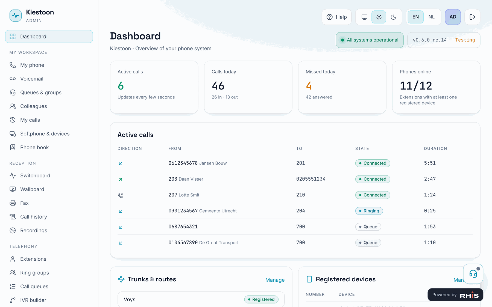
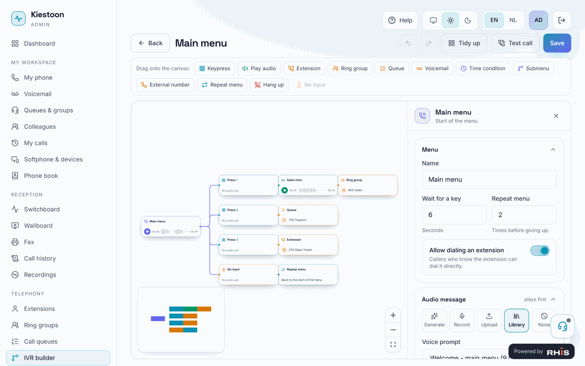
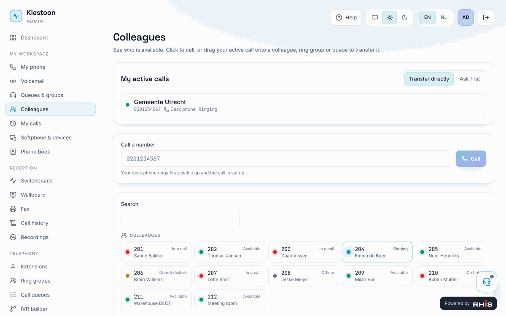
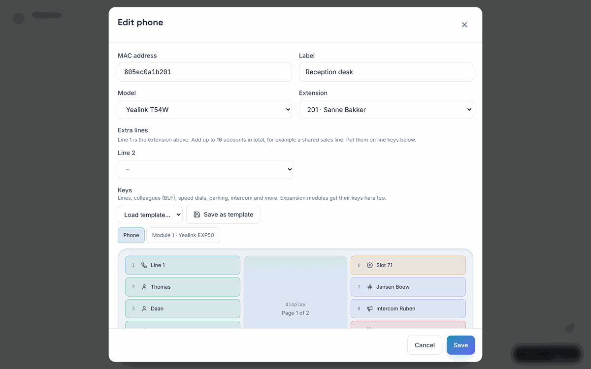

<p align="center"></p>

<h1 align="center">Kiestoon</h1>

<p align="center">
  <b>The open source phone system for small and growing businesses.</b><br>
  One Debian 13 server or Proxmox container, a modern web portal, and everything from extensions to branch offices.<br>
  English by default, fully translated into Dutch. Powered by RHIS.
</p>

<p align="center">
  <a href="https://rhisijmuiden.github.io/Kiestoon/"><b>📖 Manual</b></a> ·
  <a href="https://rhisijmuiden.github.io/Kiestoon/nl/">Handleiding (Nederlands)</a> ·
  <a href="README.nl.md">README in het Nederlands</a> ·
  <a href="https://github.com/rhisijmuiden/Kiestoon/releases">Releases</a> ·
  <a href="ROADMAP.md">Roadmap</a>
</p>

<p align="center"></p>

Kiestoon is a single-tenant PBX built on **Asterisk 22 LTS**, with a Go backend and a React portal. You install it in
minutes, set it up in the browser, and the people in the office manage their own phone in the user portal. Every
page of the portal has a **Help** button that opens the matching page of the [manual](https://rhisijmuiden.github.io/Kiestoon/), in your language.

> Status: **v0.6, testing channel**. Everything of a small-business PBX, plus branch offices, linked systems and high
> availability. See the [roadmap](ROADMAP.md).

## What you can do with it

<table>
<tr>
<td width="50%" valign="top">

### 🧭 Visual IVR builder
Draw the call flow on a canvas: menus, time conditions, queues and voicemail, connected by dragging lines. Test a
menu by letting Kiestoon call you. [Read more](https://rhisijmuiden.github.io/Kiestoon/ivr/)

</td>
<td width="50%" valign="top">



</td>
</tr>
<tr>
<td valign="top">



</td>
<td valign="top">

### 🤝 Drag-and-drop transfer
Every employee sees who is available, and transfers a call by dragging it onto a colleague, ring group or queue:
directly or after asking first. Reception has a full switchboard and a wallboard.
[Read more](https://rhisijmuiden.github.io/Kiestoon/portal/#colleagues-and-drag-and-drop-transfer)

</td>
</tr>
<tr>
<td valign="top">

### ☎️ Phones that set themselves up
Yealink, Snom, Fanvil, Grandstream, Gigaset, Poly, Htek, Akuvox and Cisco phones are provisioned automatically: plug in, link to an
extension, done. A visual key editor with expansion modules, key templates and intercom.
[Read more](https://rhisijmuiden.github.io/Kiestoon/phones/)

</td>
<td valign="top">



</td>
</tr>
<tr>
<td valign="top">


</td>
<td valign="top">

### 🏢 Branch offices, linked systems and failover
A Raspberry Pi with Kiestoon Edge connects a branch office through a WireGuard tunnel, without port forwarding.
Link Kiestoon systems in different countries with one phone book and follow-the-sun routing, and run an
active/passive pair that takes over within seconds. [Read more](https://rhisijmuiden.github.io/Kiestoon/edge/)

</td>
</tr>
</table>

### Everything else

| | |
| --- | --- |
| **Telephony** | Extensions, ring groups, call queues with agents and wallboard, time conditions with Dutch public holidays, conference rooms, call parking, feature codes, voicemail to e-mail, fax to e-mail and PDF, call recording |
| **Providers** | Trunk templates with step-by-step guides (Voys and others), inbound and outbound routes, number plan wizard, emergency calls that always work |
| **Speech** | Text-to-speech (Piper) for menus and voicemail transcription (Whisper), on the server itself: no audio leaves the phone system |
| **User portal** | Do not disturb, forward to mobile, follow me, own hours, voicemail with greetings, queue sign-in, call history, browser softphone, QR code for SIP apps |
| **Windows softphone** | Tray app with contacts, presence, queues, headset buttons (Jabra, Poly, EPOS), `tel:` links and self-update |
| **Security** | Roles, MFA, passkeys, single sign-on (Entra ID, Google, Keycloak, authentik, OIDC, SAML), nftables firewall with safe mode, fail2ban, geo-blocking, toll-fraud protection, audit log |
| **System** | Let's Encrypt with Caddy or your own reverse proxy, encrypted backups (FTP, FTPS, SFTP, SCP, S3, WebDAV, SMB, OneDrive) with full and incremental runs and restore, own SMTP server with OAuth2, REST API, webhooks, Prometheus metrics, updates from the portal with a production and a testing channel |

## Install

### Proxmox LXC template

Download `kiestoon-<version>-debian-13-amd64.tar.zst` from the [releases](https://github.com/rhisijmuiden/Kiestoon/releases),
upload it to Proxmox (*storage › CT Templates › Upload*) and create a container from it
(unprivileged is fine; 1 CPU, 1 GB RAM, 8 GB disk to start). Log in on the console as root:
the address of the portal and the one-time setup token are shown.

### Debian 13 server or VM

```sh
curl -fsSL https://raw.githubusercontent.com/rhisijmuiden/Kiestoon/testing/install.sh | sudo bash
# or follow the testing channel:
curl -fsSL https://raw.githubusercontent.com/rhisijmuiden/Kiestoon/testing/install.sh | sudo bash -s -- --channel testing
```

Until the first stable release, only the testing channel has releases, so use `--channel testing` for now.

Open `http://<server>:8080` (or `https://<server>:8443` with a self-signed certificate), enter the setup token and
create the first administrator. Administrators must set up two-factor authentication on first sign-in. Show the
setup token again with `sudo kiestoon setup-token`.

Then follow [First setup](https://rhisijmuiden.github.io/Kiestoon/first-setup/) in the manual: a trunk, extensions, phones and an inbound route, and the
first call works.

## Ports

| Port | What |
| --- | --- |
| 8080/tcp, 8443/tcp | Portal (HTTP, HTTPS) and phone provisioning (`/prov/`) |
| 5060/udp+tcp, 5061/tcp | SIP, SIP over TLS |
| 10000-20000/udp | Audio (RTP) |
| 51820/udp | WireGuard for branch offices and linked systems (only when switched on) |
| 51821/udp | WireGuard between the two nodes of a high-availability pair (only when switched on) |

The firewall page in the portal opens exactly these, with a SIP whitelist and a safe mode that undoes a change
if you lose access.

## Updates and channels

| Channel | Branch | Releases |
| --- | --- | --- |
| Production | `main` | Stable versions, `vX.Y.Z` |
| Testing | `testing` | Release candidates, `vX.Y.Z-rc.N` |

In the portal, open **Info & updates** (bottom of the left menu) to see the version, switch channel,
check for updates and install one. The updater makes a backup of `/var/lib/kiestoon` to
`/var/lib/kiestoon-backups` before every update (the newest 5 are kept).

## Layout

| Path | What |
| --- | --- |
| `server/` | Go backend: API, auth, SQLite store, updater client. Single binary with the UI embedded |
| `web/` | React + TypeScript + Tailwind portal, translations in `web/src/i18n/` |
| `branding/` | House style: tokens, logos, usage rules |
| `packaging/` | `.deb` (nfpm), systemd units, updater script, Asterisk build (`packaging/asterisk/`) |
| `lxc/` | Proxmox LXC template build (Kiestoon and Kiestoon Edge) |
| `packaging/edge/` | Kiestoon Edge package and Raspberry Pi image |
| `install.sh` | Installer for Debian 13 |

On an installed system:

| Path | What |
| --- | --- |
| `/etc/kiestoon/kiestoon.env` | Settings (port, data dir, default channel) |
| `/var/lib/kiestoon/` | All state: database, generated Asterisk config (`pbx/`), voicemail, mail queue |
| `/etc/asterisk/` | Static Asterisk config that includes the generated files. Do not edit by hand |
| `/var/lib/kiestoon-backups/` | Automatic pre-update backups |

## Manual

The manual in `docs/` is built with MkDocs Material and published on GitHub Pages by
`.github/workflows/docs.yml`, with screenshots made from a demo office in every build. See
[tools/docs/README.md](tools/docs/README.md) to preview it locally.

## Development

Needs Go (see `server/go.mod`) and Node.js 22.

```sh
make run                 # API on :8080 with a local data dir
cd web && npm run dev    # UI with hot reload on :5173, proxies /api to :8080
make test                # Go tests, translation check, type check
make deb                 # .deb in dist/ (needs nfpm)
```

Branches: work on a feature branch, open a pull request into `testing`.

Releases: set the new version in the `VERSION` file (`vX.Y.Z-rc.N` on `testing`, `vX.Y.Z` on `main`) and merge.
The release workflow then creates the tag and a GitHub release with the `.deb` packages, the LXC template and
`SHA256SUMS`. Pushing a `v*` tag works too.

## Licence

GPL-3.0. See [LICENSE](LICENSE).
