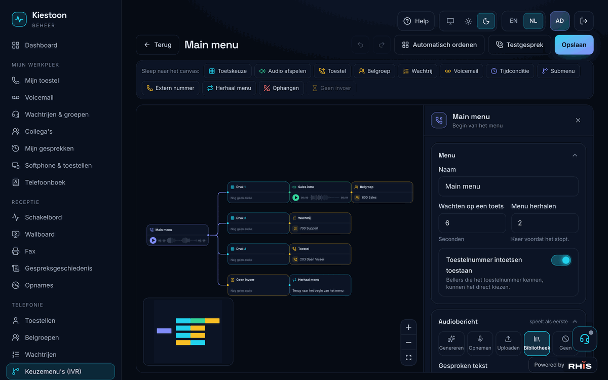
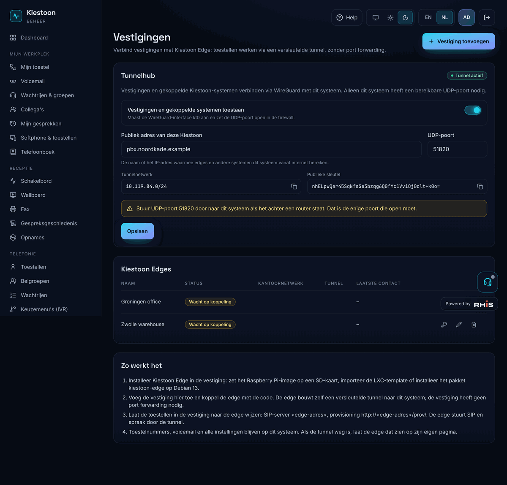

<p align="center"></p>

<h1 align="center">Kiestoon</h1>

<p align="center">
  <b>De open source telefooncentrale voor kleine en groeiende bedrijven.</b><br>
  Eén Debian 13-server of Proxmox-container, een modern webportaal, en alles van toestellen tot vestigingen.<br>
  Standaard in het Engels, volledig vertaald in het Nederlands. Powered by RHIS.
</p>

<p align="center">
  <a href="https://rhisijmuiden.github.io/Kiestoon/nl/"><b>📖 Handleiding</b></a> ·
  <a href="https://rhisijmuiden.github.io/Kiestoon/">Manual (English)</a> ·
  <a href="README.md">README in English</a> ·
  <a href="https://github.com/rhisijmuiden/Kiestoon/releases">Releases</a> ·
  <a href="ROADMAP.md">Roadmap</a>
</p>

<p align="center"></p>

Kiestoon is een single-tenant telefooncentrale op **Asterisk 22 LTS**, met een Go-backend en een React-portaal. Je
installeert hem in een paar minuten, richt hem in via de browser, en de mensen op kantoor regelen hun eigen telefoon
in het gebruikersportaal. Elke pagina van het portaal heeft een knop **Help** die de bijbehorende pagina van de
[handleiding](https://rhisijmuiden.github.io/Kiestoon/nl/) opent, in je eigen taal.

> Status: **v0.6, testkanaal**. Alles van een telefooncentrale voor het mkb, plus vestigingen, gekoppelde systemen en
> hoge beschikbaarheid. Zie de [roadmap](ROADMAP.md).

## Wat je ermee kunt

<table>
<tr>
<td width="50%" valign="top">

### 🧭 Keuzemenu's tekenen
Teken de route van een gesprek op een canvas: keuzemenu's, tijdcondities, wachtrijen en voicemail, verbonden door
lijnen te slepen. Test een menu door Kiestoon jou te laten bellen. [Lees meer](https://rhisijmuiden.github.io/Kiestoon/nl/ivr/)

</td>
<td width="50%" valign="top">



</td>
</tr>
<tr>
<td valign="top">


</td>
<td valign="top">

### 🤝 Doorverbinden met slepen
Elke medewerker ziet wie er beschikbaar is en verbindt een gesprek door door het naar een collega, belgroep of
wachtrij te slepen: direct of na eerst overleggen. De receptie heeft een compleet schakelbord en een wallboard.
[Lees meer](https://rhisijmuiden.github.io/Kiestoon/nl/portal/#collegas-en-doorverbinden-met-slepen)

</td>
</tr>
<tr>
<td valign="top">

### ☎️ Telefoons die zichzelf instellen
Yealink-, Snom-, Fanvil-, Grandstream-, Gigaset-, Poly-, Htek-, Akuvox- en Cisco-telefoons worden automatisch ingesteld: aansluiten,
koppelen aan een toestel, klaar. Met een visuele toetseneditor met uitbreidingsmodules, toetssjablonen en intercom.
[Lees meer](https://rhisijmuiden.github.io/Kiestoon/nl/phones/)

</td>
<td valign="top">


</td>
</tr>
<tr>
<td valign="top">



</td>
<td valign="top">

### 🏢 Vestigingen, gekoppelde systemen en failover
Een Raspberry Pi met Kiestoon Edge verbindt een vestiging via een WireGuard-tunnel, zonder port forwarding. Koppel
Kiestoon-systemen in verschillende landen met één telefoonboek en follow-the-sun-routering, en draai een
actief/passief-paar dat het binnen enkele seconden overneemt. [Lees meer](https://rhisijmuiden.github.io/Kiestoon/nl/edge/)

</td>
</tr>
</table>

### En verder

| | |
| --- | --- |
| **Telefonie** | Toestellen, belgroepen, wachtrijen met medewerkers en wallboard, tijdcondities met Nederlandse feestdagen, vergaderruimtes, gesprek parkeren, sneltoetscodes, voicemail naar e-mail, fax naar e-mail en PDF, gesprekken opnemen |
| **Providers** | Trunksjablonen met stappenplannen (Voys en anderen), inkomende en uitgaande routes, wizard voor het nummerplan, alarmnummers die altijd werken |
| **Spraak** | Tekst-naar-spraak (Piper) voor menu's en uitgeschreven voicemail (Whisper), op de server zelf: er gaat geen audio de centrale uit |
| **Gebruikersportaal** | Niet storen, doorschakelen naar mobiel, volg mij, eigen tijden, voicemail met begroetingen, aanmelden bij wachtrijen, gespreksgeschiedenis, softphone in de browser, QR-code voor SIP-apps |
| **Windows-softphone** | App in het systeemvak met contacten, aanwezigheid, wachtrijen, headsetknoppen (Jabra, Poly, EPOS), `tel:`-links en automatisch bijwerken |
| **Beveiliging** | Rollen, MFA, passkeys, single sign-on (Entra ID, Google, Keycloak, authentik, OIDC, SAML), nftables-firewall met veilige modus, fail2ban, geo-blokkering, bescherming tegen belfraude, auditlog |
| **Systeem** | Let's Encrypt met Caddy of je eigen reverse proxy, versleutelde back-ups (FTP, FTPS, SFTP, SCP, S3, WebDAV, SMB, OneDrive) volledig en incrementeel met herstellen, eigen SMTP-server met OAuth2, REST-API, webhooks, Prometheus-metrics, updates vanuit het portaal met een productie- en een testkanaal |

## Alle functies

Elk onderdeel van Kiestoon met een screenshot uit de echte app (licht of donker, net als je GitHub-thema). Klik op een plaatje voor het hoofdstuk in de [handleiding](https://rhisijmuiden.github.io/Kiestoon/nl/features/).

<!-- features:start -->

#### Telefonie

<table>
<tr>
<td width="50%" valign="top"><a href="https://rhisijmuiden.github.io/Kiestoon/nl/"><picture><source media="(prefers-color-scheme: dark)" srcset="https://rhisijmuiden.github.io/Kiestoon/assets/screenshots/nl/dark/dashboard.png"></picture></a><br><b>Live dashboard</b><br>Lopende gesprekken, aangemelde telefoons, trunks en wachtrijen in één oogopslag.</td>
<td width="50%" valign="top"><a href="https://rhisijmuiden.github.io/Kiestoon/nl/extensions/"><picture><source media="(prefers-color-scheme: dark)" srcset="https://rhisijmuiden.github.io/Kiestoon/assets/screenshots/nl/dark/extensions.png"></picture></a><br><b>Toestellen</b><br>Eén pagina per toestel: telefoons, voicemail, doorschakelen, opnemen en de gekoppelde gebruiker.</td>
</tr>
<tr>
<td width="50%" valign="top"><a href="https://rhisijmuiden.github.io/Kiestoon/nl/ring-groups/"><picture><source media="(prefers-color-scheme: dark)" srcset="https://rhisijmuiden.github.io/Kiestoon/assets/screenshots/nl/dark/ring-groups.png"></picture></a><br><b>Belgroepen</b><br>Laat meerdere telefoons tegelijk of na elkaar overgaan, met een uitwijk als niemand opneemt.</td>
<td width="50%" valign="top"><a href="https://rhisijmuiden.github.io/Kiestoon/nl/queues/"><picture><source media="(prefers-color-scheme: dark)" srcset="https://rhisijmuiden.github.io/Kiestoon/assets/screenshots/nl/dark/queues.png"></picture></a><br><b>Wachtrijen</b><br>Agents, strategieën, wachtmuziek, positiemeldingen en terugbellen in plaats van wachten.</td>
</tr>
<tr>
<td width="50%" valign="top"><a href="https://rhisijmuiden.github.io/Kiestoon/nl/ivr/"><picture><source media="(prefers-color-scheme: dark)" srcset="https://rhisijmuiden.github.io/Kiestoon/assets/screenshots/nl/dark/ivr-canvas.png"></picture></a><br><b>Visuele keuzemenu-bouwer</b><br>Teken de belroute op een canvas en verbind de blokken door lijnen te slepen.</td>
<td width="50%" valign="top"><a href="https://rhisijmuiden.github.io/Kiestoon/nl/ivr/"><picture><source media="(prefers-color-scheme: dark)" srcset="https://rhisijmuiden.github.io/Kiestoon/assets/screenshots/nl/dark/ivr-speech.png"></picture></a><br><b>Gesproken menu's en spraakinvoer</b><br>Typ de tekst van een menu en laat hem uitspreken; bellers kunnen ook zeggen wat ze willen.</td>
</tr>
<tr>
<td width="50%" valign="top"><a href="https://rhisijmuiden.github.io/Kiestoon/nl/time-conditions/"><picture><source media="(prefers-color-scheme: dark)" srcset="https://rhisijmuiden.github.io/Kiestoon/assets/screenshots/nl/dark/time-conditions.png"></picture></a><br><b>Tijdcondities en feestdagen</b><br>Openingstijden per route, met de Nederlandse feestdagen al ingevuld.</td>
<td width="50%" valign="top"><a href="https://rhisijmuiden.github.io/Kiestoon/nl/conferences/"><picture><source media="(prefers-color-scheme: dark)" srcset="https://rhisijmuiden.github.io/Kiestoon/assets/screenshots/nl/dark/conferences.png"></picture></a><br><b>Vergaderruimtes</b><br>Inbelruimtes met pincode, moderator en optionele opname.</td>
</tr>
<tr>
<td width="50%" valign="top"><a href="https://rhisijmuiden.github.io/Kiestoon/nl/prompts/"><picture><source media="(prefers-color-scheme: dark)" srcset="https://rhisijmuiden.github.io/Kiestoon/assets/screenshots/nl/dark/voice-picker.png"></picture></a><br><b>Gesproken teksten en ElevenLabs-stemmen</b><br>Neem teksten op, upload ze of laat ze maken met een lokale stem of een ElevenLabs-stem.</td>
<td width="50%" valign="top"><a href="https://rhisijmuiden.github.io/Kiestoon/nl/fax/"><picture><source media="(prefers-color-scheme: dark)" srcset="https://rhisijmuiden.github.io/Kiestoon/assets/screenshots/nl/dark/fax.png"></picture></a><br><b>Voicemail en fax naar e-mail</b><br>Voicemail met uitgeschreven tekst en binnenkomende faxen als pdf in je mailbox.</td>
</tr>
<tr>
<td width="50%" valign="top"><a href="https://rhisijmuiden.github.io/Kiestoon/nl/call-journey/"><picture><source media="(prefers-color-scheme: dark)" srcset="https://rhisijmuiden.github.io/Kiestoon/assets/screenshots/nl/dark/call-journey.png"></picture></a><br><b>Gespreksgeschiedenis en gespreksroute</b><br>Zoek elk gesprek terug en zie de route stap voor stap: menu, wachtrij, wie opnam.</td>
<td width="50%" valign="top"><a href="https://rhisijmuiden.github.io/Kiestoon/nl/ai/"><picture><source media="(prefers-color-scheme: dark)" srcset="https://rhisijmuiden.github.io/Kiestoon/assets/screenshots/nl/dark/recording-ai.png"></picture></a><br><b>Opnames met AI-samenvattingen</b><br>Luister terug, lees het uitgeschreven gesprek en een korte samenvatting, lokaal of met Claude.</td>
</tr>
<tr>
<td width="50%" valign="top"><a href="https://rhisijmuiden.github.io/Kiestoon/nl/call-quality/"><picture><source media="(prefers-color-scheme: dark)" srcset="https://rhisijmuiden.github.io/Kiestoon/assets/screenshots/nl/dark/call-quality.png"></picture></a><br><b>Gesprekskwaliteit</b><br>MOS, jitter en pakketverlies per gesprek, met meldingen als de kwaliteit zakt.</td>
<td width="50%" valign="top"><a href="https://rhisijmuiden.github.io/Kiestoon/nl/feature-codes/"><picture><source media="(prefers-color-scheme: dark)" srcset="https://rhisijmuiden.github.io/Kiestoon/assets/screenshots/nl/dark/features.png"></picture></a><br><b>Sterretjescodes</b><br>Codes voor parkeren, overnemen, niet storen, flexplekken en meer, allemaal aan te passen.</td>
</tr>
</table>

#### Providers en Teams

<table>
<tr>
<td width="50%" valign="top"><a href="https://rhisijmuiden.github.io/Kiestoon/nl/trunks/"><picture><source media="(prefers-color-scheme: dark)" srcset="https://rhisijmuiden.github.io/Kiestoon/assets/screenshots/nl/dark/trunk-edit.png"></picture></a><br><b>Trunks met providersjablonen</b><br>Kant-en-klare sjablonen voor Voys, Cheapconnect, Speakup, KPN en Vodafone Ziggo, elk met een handleiding.</td>
<td width="50%" valign="top"><a href="https://rhisijmuiden.github.io/Kiestoon/nl/teams/"><picture><source media="(prefers-color-scheme: dark)" srcset="https://rhisijmuiden.github.io/Kiestoon/assets/screenshots/nl/dark/teams-users.png"></picture></a><br><b>Microsoft Teams Direct Routing</b><br>Teams-gebruikers bellen en worden gebeld via Kiestoon, als toestel zoals elk ander.</td>
</tr>
</table>

#### Telefoons

<table>
<tr>
<td width="50%" valign="top"><a href="https://rhisijmuiden.github.io/Kiestoon/nl/phones/"><picture><source media="(prefers-color-scheme: dark)" srcset="https://rhisijmuiden.github.io/Kiestoon/assets/screenshots/nl/dark/phones.png"></picture></a><br><b>Automatische provisioning</b><br>Yealink, Snom, Fanvil, Grandstream, Gigaset, Poly, Htek, Akuvox en Cisco: aansluiten, koppelen, klaar.</td>
<td width="50%" valign="top"><a href="https://rhisijmuiden.github.io/Kiestoon/nl/phone-keys/"><picture><source media="(prefers-color-scheme: dark)" srcset="https://rhisijmuiden.github.io/Kiestoon/assets/screenshots/nl/dark/phone-keys.png"></picture></a><br><b>Toetsen en uitbreidingsmodules</b><br>Een visuele toetseneditor met modules, toetssjablonen en intercom.</td>
</tr>
</table>

#### Receptie

<table>
<tr>
<td width="50%" valign="top"><a href="https://rhisijmuiden.github.io/Kiestoon/nl/switchboard/"><picture><source media="(prefers-color-scheme: dark)" srcset="https://rhisijmuiden.github.io/Kiestoon/assets/screenshots/nl/dark/switchboard.png"></picture></a><br><b>Schakelbord</b><br>Elk gesprek en elke collega op één scherm; doorverbinden door te slepen.</td>
<td width="50%" valign="top"><a href="https://rhisijmuiden.github.io/Kiestoon/nl/wallboard/"><picture><source media="(prefers-color-scheme: dark)" srcset="https://rhisijmuiden.github.io/Kiestoon/assets/screenshots/nl/dark/wallboard-tv.png"></picture></a><br><b>Wallboard en tv-schermen</b><br>Wachtrijcijfers en agents live op een tv, met een ontwerper en een eigen adres per scherm.</td>
</tr>
<tr>
<td width="50%" valign="top"><a href="https://rhisijmuiden.github.io/Kiestoon/nl/wallboard/"><picture><source media="(prefers-color-scheme: dark)" srcset="https://rhisijmuiden.github.io/Kiestoon/assets/screenshots/nl/dark/report-preview.png"></picture></a><br><b>Meldingen en geplande rapporten</b><br>Meldingen als het serviceniveau zakt, en rapporten per e-mail.</td>
<td width="50%" valign="top"><a href="https://rhisijmuiden.github.io/Kiestoon/nl/phonebook/"><picture><source media="(prefers-color-scheme: dark)" srcset="https://rhisijmuiden.github.io/Kiestoon/assets/screenshots/nl/dark/phonebook.png"></picture></a><br><b>Telefoonboek</b><br>Gedeelde contacten op elke telefoon, in de softphone en voor namen van bellers.</td>
</tr>
</table>

#### Voor elke medewerker

<table>
<tr>
<td width="50%" valign="top"><a href="https://rhisijmuiden.github.io/Kiestoon/nl/portal/"><picture><source media="(prefers-color-scheme: dark)" srcset="https://rhisijmuiden.github.io/Kiestoon/assets/screenshots/nl/dark/my-phone.png"></picture></a><br><b>Gebruikersportaal</b><br>Niet storen, doorschakelen, follow me, eigen tijden en voicemail, alles op één plek.</td>
<td width="50%" valign="top"><a href="https://rhisijmuiden.github.io/Kiestoon/nl/portal/"><picture><source media="(prefers-color-scheme: dark)" srcset="https://rhisijmuiden.github.io/Kiestoon/assets/screenshots/nl/dark/colleagues.png"></picture></a><br><b>Collega's en doorverbinden met slepen</b><br>Zie wie beschikbaar is en verbind door door een gesprek op een collega te slepen.</td>
</tr>
<tr>
<td width="50%" valign="top"><a href="https://rhisijmuiden.github.io/Kiestoon/nl/softphone/"><picture><source media="(prefers-color-scheme: dark)" srcset="https://rhisijmuiden.github.io/Kiestoon/assets/screenshots/nl/dark/softphone-contacts.png"></picture></a><br><b>Windows-softphone</b><br>Tray-app met contacten, aanwezigheid, wachtrijen en headsetknoppen.</td>
<td width="50%" valign="top"><a href="https://rhisijmuiden.github.io/Kiestoon/nl/mobile-app/"><picture><source media="(prefers-color-scheme: dark)" srcset="https://rhisijmuiden.github.io/Kiestoon/assets/screenshots/nl/dark/mobile-app.png"></picture></a><br><b>Mobiele app</b><br>Gesprekken op je mobiel met pushmeldingen, gekoppeld met een QR-code.</td>
</tr>
</table>

#### Meerdere locaties en hoge beschikbaarheid

<table>
<tr>
<td width="50%" valign="top"><a href="https://rhisijmuiden.github.io/Kiestoon/nl/edge/"><picture><source media="(prefers-color-scheme: dark)" srcset="https://rhisijmuiden.github.io/Kiestoon/assets/screenshots/nl/dark/sites.png"></picture></a><br><b>Vestigingen met Kiestoon Edge</b><br>Een Raspberry Pi verbindt een vestiging via WireGuard, zonder port forwarding.</td>
<td width="50%" valign="top"><a href="https://rhisijmuiden.github.io/Kiestoon/nl/multi-site/"><picture><source media="(prefers-color-scheme: dark)" srcset="https://rhisijmuiden.github.io/Kiestoon/assets/screenshots/nl/dark/follow-the-sun.png"></picture></a><br><b>Gekoppelde systemen en follow the sun</b><br>Eén telefoonboek over landen heen, en gesprekken volgen het kantoor dat open is.</td>
</tr>
<tr>
<td width="50%" valign="top"><a href="https://rhisijmuiden.github.io/Kiestoon/nl/high-availability/"><picture><source media="(prefers-color-scheme: dark)" srcset="https://rhisijmuiden.github.io/Kiestoon/assets/screenshots/nl/dark/cluster.png"></picture></a><br><b>Hoge beschikbaarheid</b><br>Een actief/passief paar dat binnen seconden overneemt.</td>
<td width="50%"></td>
</tr>
</table>

#### Beveiliging

<table>
<tr>
<td width="50%" valign="top"><a href="https://rhisijmuiden.github.io/Kiestoon/nl/users/"><picture><source media="(prefers-color-scheme: dark)" srcset="https://rhisijmuiden.github.io/Kiestoon/assets/screenshots/nl/dark/sso.png"></picture></a><br><b>Gebruikers, rollen, MFA en single sign-on</b><br>Verplichte MFA voor beheerders, passkeys, en inloggen met Entra ID, Google of OIDC/SAML.</td>
<td width="50%" valign="top"><a href="https://rhisijmuiden.github.io/Kiestoon/nl/firewall/"><picture><source media="(prefers-color-scheme: dark)" srcset="https://rhisijmuiden.github.io/Kiestoon/assets/screenshots/nl/dark/firewall.png"></picture></a><br><b>Firewall en fraudebescherming</b><br>nftables-firewall met veilige modus, fail2ban, geoblokkering en vertrouwde netwerken.</td>
</tr>
<tr>
<td width="50%" valign="top"><a href="https://rhisijmuiden.github.io/Kiestoon/nl/internet/"><picture><source media="(prefers-color-scheme: dark)" srcset="https://rhisijmuiden.github.io/Kiestoon/assets/screenshots/nl/dark/internet.png"></picture></a><br><b>Internettoegang en SSL</b><br>Let's Encrypt met de ingebouwde Caddy, of je eigen reverse proxy.</td>
<td width="50%" valign="top"><a href="https://rhisijmuiden.github.io/Kiestoon/nl/users/"><picture><source media="(prefers-color-scheme: dark)" srcset="https://rhisijmuiden.github.io/Kiestoon/assets/screenshots/nl/dark/audit.png"></picture></a><br><b>Auditlog</b><br>Wie wat wanneer heeft gewijzigd.</td>
</tr>
</table>

#### Systeem en koppelingen

<table>
<tr>
<td width="50%" valign="top"><a href="https://rhisijmuiden.github.io/Kiestoon/nl/crm/"><picture><source media="(prefers-color-scheme: dark)" srcset="https://rhisijmuiden.github.io/Kiestoon/assets/screenshots/nl/dark/crm.png"></picture></a><br><b>CRM-koppelingen en gesprekspop-up</b><br>Zie de klant uit je CRM als de telefoon gaat, en log gesprekken automatisch.</td>
<td width="50%" valign="top"><a href="https://rhisijmuiden.github.io/Kiestoon/nl/api/"><picture><source media="(prefers-color-scheme: dark)" srcset="https://rhisijmuiden.github.io/Kiestoon/assets/screenshots/nl/dark/integrations.png"></picture></a><br><b>API, webhooks en metrics</b><br>REST-API met tokens, ondertekende webhooks en Prometheus-metrics.</td>
</tr>
<tr>
<td width="50%" valign="top"><a href="https://rhisijmuiden.github.io/Kiestoon/nl/backups/"><picture><source media="(prefers-color-scheme: dark)" srcset="https://rhisijmuiden.github.io/Kiestoon/assets/screenshots/nl/dark/backups.png"></picture></a><br><b>Back-ups en herstel</b><br>Volledige en incrementele back-ups naar FTP, FTPS, SFTP, SCP en meer, en herstel van daaruit.</td>
<td width="50%" valign="top"><a href="https://rhisijmuiden.github.io/Kiestoon/nl/mail/"><picture><source media="(prefers-color-scheme: dark)" srcset="https://rhisijmuiden.github.io/Kiestoon/assets/screenshots/nl/dark/mail.png"></picture></a><br><b>Eigen mailserver</b><br>Je eigen SMTP-server met TLS en OAuth2 voor alle mail die Kiestoon verstuurt.</td>
</tr>
<tr>
<td width="50%" valign="top"><a href="https://rhisijmuiden.github.io/Kiestoon/nl/updates/"><picture><source media="(prefers-color-scheme: dark)" srcset="https://rhisijmuiden.github.io/Kiestoon/assets/screenshots/nl/dark/info.png"></picture></a><br><b>Updates vanuit het portaal</b><br>Versie-informatie, controleren op updates en updaten, op een productie- of testkanaal.</td>
<td width="50%"></td>
</tr>
</table>
<!-- features:end -->

## Installeren

### Proxmox LXC-template

Open in Proxmox *opslag › CT Templates › **Download from URL***, plak deze URL en klik op *Query URL* en *Download*:

```text
https://github.com/rhisijmuiden/Kiestoon/releases/latest/download/kiestoon-debian-13-amd64.tar.zst
```

(Tot de eerste stabiele release gebruik je dezelfde bestandsnaam van de nieuwste
[release candidate](https://github.com/rhisijmuiden/Kiestoon/releases) in plaats van `latest`.) Maak een container van
het template (unprivileged, nesting aan; 1 CPU, 1 GB RAM, 8 GB schijf om mee te beginnen) en start hem. De console
toont de URL, gebruikersnaam en het wachtwoord.

Of doe alles met één commando in de shell van de Proxmox-host (voeg `-- --download-only` toe om alleen het template te
downloaden, of `-- --edge` voor Kiestoon Edge):

```sh
bash -c "$(curl -fsSL https://raw.githubusercontent.com/rhisijmuiden/Kiestoon/testing/proxmox/kiestoon-lxc.sh)"
```

### Debian 13-server of VM

```sh
curl -fsSL https://raw.githubusercontent.com/rhisijmuiden/Kiestoon/testing/install.sh | sudo bash
# of volg het testkanaal:
curl -fsSL https://raw.githubusercontent.com/rhisijmuiden/Kiestoon/testing/install.sh | sudo bash -s -- --channel testing
```

Tot de eerste stabiele release heeft alleen het testkanaal releases, dus gebruik voorlopig `--channel testing`.

Het script werkt op een kale Debian 13, op hardware, in een VM of in een container. Aan het eind toont het alleen de
URL, de gebruikersnaam (`admin`) en een aangemaakt wachtwoord. Meld je daarmee aan op `http://<server>:8080`: je kiest
dan je eigen wachtwoord en de naam van je organisatie, stelt tweestapsverificatie in, en richt de rest in het portaal
in. Toon de gegevens opnieuw met `sudo kiestoon initial-admin`.

Volg daarna [Eerste inrichting](https://rhisijmuiden.github.io/Kiestoon/nl/first-setup/) in de handleiding: een trunk, toestellen, telefoons en een
inkomende route, en het eerste gesprek werkt.

## Meer

Poorten, updatekanalen, de opbouw van de repository en ontwikkelen staan in de [Engelse README](README.md#ports) en
in de [handleiding](https://rhisijmuiden.github.io/Kiestoon/nl/).

## Licentie

GPL-3.0. Zie [LICENSE](LICENSE).
