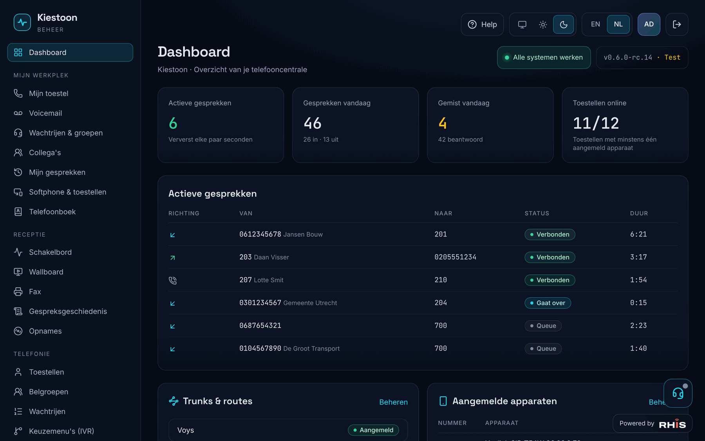
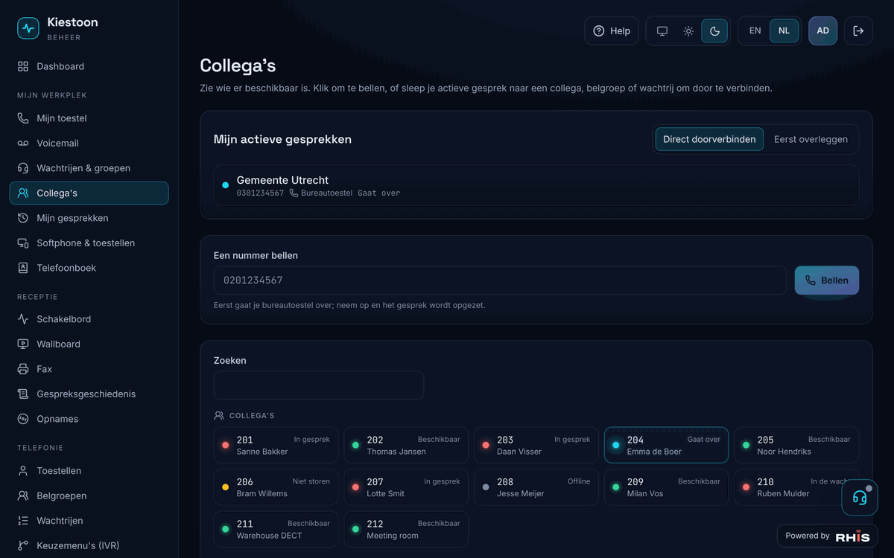

<p align="center"></p>

<h1 align="center">Kiestoon</h1>

<p align="center">
  <b>De open source telefooncentrale voor kleine en groeiende bedrijven.</b><br>
  Eén Debian 13-server of Proxmox-container, een modern webportaal, en alles van toestellen tot vestigingen.<br>
  Standaard in het Engels, volledig vertaald in het Nederlands. Powered by RHIS.
</p>

<p align="center">
  <a href="https://rhisijmuiden.github.io/Kiestoon/nl/"><b>📖 Handleiding</b></a> ·
  <a href="https://rhisijmuiden.github.io/Kiestoon/">Manual (English)</a> ·
  <a href="README.md">README in English</a> ·
  <a href="https://github.com/rhisijmuiden/Kiestoon/releases">Releases</a> ·
  <a href="ROADMAP.md">Roadmap</a>
</p>

<p align="center"></p>

Kiestoon is een single-tenant telefooncentrale op **Asterisk 22 LTS**, met een Go-backend en een React-portaal. Je
installeert hem in een paar minuten, richt hem in via de browser, en de mensen op kantoor regelen hun eigen telefoon
in het gebruikersportaal. Elke pagina van het portaal heeft een knop **Help** die de bijbehorende pagina van de
[handleiding](https://rhisijmuiden.github.io/Kiestoon/nl/) opent, in je eigen taal.

> Status: **v0.6, testkanaal**. Alles van een telefooncentrale voor het mkb, plus vestigingen, gekoppelde systemen en
> hoge beschikbaarheid. Zie de [roadmap](ROADMAP.md).

## Wat je ermee kunt

<table>
<tr>
<td width="50%" valign="top">

### 🧭 Keuzemenu's tekenen
Teken de route van een gesprek op een canvas: keuzemenu's, tijdcondities, wachtrijen en voicemail, verbonden door
lijnen te slepen. Test een menu door Kiestoon jou te laten bellen. [Lees meer](https://rhisijmuiden.github.io/Kiestoon/nl/ivr/)

</td>
<td width="50%" valign="top">


</td>
</tr>
<tr>
<td valign="top">



</td>
<td valign="top">

### 🤝 Doorverbinden met slepen
Elke medewerker ziet wie er beschikbaar is en verbindt een gesprek door door het naar een collega, belgroep of
wachtrij te slepen: direct of na eerst overleggen. De receptie heeft een compleet schakelbord en een wallboard.
[Lees meer](https://rhisijmuiden.github.io/Kiestoon/nl/portal/#collegas-en-doorverbinden-met-slepen)

</td>
</tr>
<tr>
<td valign="top">

### ☎️ Telefoons die zichzelf instellen
Yealink-, Snom-, Fanvil-, Grandstream-, Gigaset-, Poly-, Htek-, Akuvox- en Cisco-telefoons worden automatisch ingesteld: aansluiten,
koppelen aan een toestel, klaar. Met een visuele toetseneditor met uitbreidingsmodules, toetssjablonen en intercom.
[Lees meer](https://rhisijmuiden.github.io/Kiestoon/nl/phones/)

</td>
<td valign="top">


</td>
</tr>
<tr>
<td valign="top">


</td>
<td valign="top">

### 🏢 Vestigingen, gekoppelde systemen en failover
Een Raspberry Pi met Kiestoon Edge verbindt een vestiging via een WireGuard-tunnel, zonder port forwarding. Koppel
Kiestoon-systemen in verschillende landen met één telefoonboek en follow-the-sun-routering, en draai een
actief/passief-paar dat het binnen enkele seconden overneemt. [Lees meer](https://rhisijmuiden.github.io/Kiestoon/nl/edge/)

</td>
</tr>
</table>

### En verder

| | |
| --- | --- |
| **Telefonie** | Toestellen, belgroepen, wachtrijen met medewerkers en wallboard, tijdcondities met Nederlandse feestdagen, vergaderruimtes, gesprek parkeren, sneltoetscodes, voicemail naar e-mail, fax naar e-mail en PDF, gesprekken opnemen |
| **Providers** | Trunksjablonen met stappenplannen (Voys en anderen), inkomende en uitgaande routes, wizard voor het nummerplan, alarmnummers die altijd werken |
| **Spraak** | Tekst-naar-spraak (Piper) voor menu's en uitgeschreven voicemail (Whisper), op de server zelf: er gaat geen audio de centrale uit |
| **Gebruikersportaal** | Niet storen, doorschakelen naar mobiel, volg mij, eigen tijden, voicemail met begroetingen, aanmelden bij wachtrijen, gespreksgeschiedenis, softphone in de browser, QR-code voor SIP-apps |
| **Windows-softphone** | App in het systeemvak met contacten, aanwezigheid, wachtrijen, headsetknoppen (Jabra, Poly, EPOS), `tel:`-links en automatisch bijwerken |
| **Beveiliging** | Rollen, MFA, passkeys, single sign-on (Entra ID, Google, Keycloak, authentik, OIDC, SAML), nftables-firewall met veilige modus, fail2ban, geo-blokkering, bescherming tegen belfraude, auditlog |
| **Systeem** | Let's Encrypt met Caddy of je eigen reverse proxy, versleutelde back-ups (FTP, FTPS, SFTP, SCP, S3, WebDAV, SMB, OneDrive) volledig en incrementeel met herstellen, eigen SMTP-server met OAuth2, REST-API, webhooks, Prometheus-metrics, updates vanuit het portaal met een productie- en een testkanaal |

## Installeren

### Proxmox LXC-template

Open in Proxmox *opslag › CT Templates › **Download from URL***, plak deze URL en klik op *Query URL* en *Download*:

```text
https://github.com/rhisijmuiden/Kiestoon/releases/latest/download/kiestoon-debian-13-amd64.tar.zst
```

(Tot de eerste stabiele release gebruik je dezelfde bestandsnaam van de nieuwste
[release candidate](https://github.com/rhisijmuiden/Kiestoon/releases) in plaats van `latest`.) Maak een container van
het template (unprivileged, nesting aan; 1 CPU, 1 GB RAM, 8 GB schijf om mee te beginnen) en start hem. De console
toont de URL, gebruikersnaam en het wachtwoord.

Of doe alles met één commando in de shell van de Proxmox-host (voeg `-- --download-only` toe om alleen het template te
downloaden, of `-- --edge` voor Kiestoon Edge):

```sh
bash -c "$(curl -fsSL https://raw.githubusercontent.com/rhisijmuiden/Kiestoon/testing/proxmox/kiestoon-lxc.sh)"
```

### Debian 13-server of VM

```sh
curl -fsSL https://raw.githubusercontent.com/rhisijmuiden/Kiestoon/testing/install.sh | sudo bash
# of volg het testkanaal:
curl -fsSL https://raw.githubusercontent.com/rhisijmuiden/Kiestoon/testing/install.sh | sudo bash -s -- --channel testing
```

Tot de eerste stabiele release heeft alleen het testkanaal releases, dus gebruik voorlopig `--channel testing`.

Het script werkt op een kale Debian 13, op hardware, in een VM of in een container. Aan het eind toont het alleen de
URL, de gebruikersnaam (`admin`) en een aangemaakt wachtwoord. Meld je daarmee aan op `http://<server>:8080`: je kiest
dan je eigen wachtwoord en de naam van je organisatie, stelt tweestapsverificatie in, en richt de rest in het portaal
in. Toon de gegevens opnieuw met `sudo kiestoon initial-admin`.

Volg daarna [Eerste inrichting](https://rhisijmuiden.github.io/Kiestoon/nl/first-setup/) in de handleiding: een trunk, toestellen, telefoons en een
inkomende route, en het eerste gesprek werkt.

## Meer

Poorten, updatekanalen, de opbouw van de repository en ontwikkelen staan in de [Engelse README](README.md#ports) en
in de [handleiding](https://rhisijmuiden.github.io/Kiestoon/nl/).

## Licentie

GPL-3.0. Zie [LICENSE](LICENSE).
