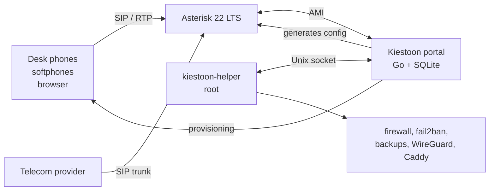

# How Kiestoon works

A few ideas come back on almost every page. Knowing them makes the rest of the manual quick to read.

## The parts

- **Asterisk 22 LTS** handles the calls. You never edit its configuration: Kiestoon generates it from the database
  and reloads only what changed.
- **The Kiestoon portal** is one program with the web interface, the REST API, provisioning for phones and the
  database (SQLite). It runs as an unprivileged user.
- **kiestoon-helper** is a small root service with a fixed list of commands: apply the firewall, run a backup or
  restore, bring up WireGuard tunnels, configure Caddy. The portal asks; the helper checks everything again.
- **kiestoon-updater** installs updates that you start from the portal, after a backup.

## Destinations

Almost everything that receives a call can send it on to a **destination**. The same list is used by inbound
routes, IVR steps, time conditions, ring group and queue failover, and follow-the-sun rules:

| Destination | Goes to |
| --- | --- |
| Extension | One person; rings all their devices |
| Voicemail | Straight to someone's voicemail box |
| Ring group | A team, all at once or one by one |
| Call queue | Callers wait in line until an agent is free |
| IVR menu | "Press 1 for sales …" |
| Time condition | Open, closed or holiday, each with its own destination |
| Conference room | A meeting number |
| Fax box | Receives a fax and mails it as PDF |
| External number | Forward to a mobile or another number (costs an outgoing call) |
| Linked system | An extension on another Kiestoon (see [linked systems](multi-site.md)) |
| Follow the sun | The team that is at work now, by time zone |
| Hang up | End the call |

A typical main number: **inbound route › time condition › IVR menu › ring group or queue**, with voicemail when
closed.

## The number plan

Internal numbers all have the same length: 3 digits by default, or 4 or 5.

| Range (3 digits) | Use |
| --- | --- |
| 200-599 | Extensions |
| 600-699 | Ring groups |
| 700-799 | Call queues (70 and 71-79 are also call parking) |
| 800-899 | Conference rooms |
| `*` codes | Voicemail and features, see [feature codes](feature-codes.md) |
| 112, 911 | Emergency, always allowed |

Change the length under **Settings › Number plan**. Existing extensions are renumbered and provisioned phones pick
up their new number by themselves.

## Roles

| Role | May |
| --- | --- |
| **Super admin** | Everything, including managing other super admins |
| **Administrator** | Manage the phone system. Always signs in with MFA |
| **Reception** | Switchboard, wallboard, call history, recordings and fax; sign agents in and out; switch day/night mode |
| **User** | Their own phone in the user portal: forwarding, voicemail, colleagues, call history, keys |

A user (of any role) who is linked to an extension also gets the **My workspace** menu: the user portal. See
[Users, roles and sign-in](users.md).

## Live state

The portal keeps a connection to Asterisk (AMI). Dashboards, the switchboard, the wallboard, colleague presence and
queue status update every few seconds. Feature codes on a phone (for example `*76` for do not disturb) report back
to the portal, so the portal and the phone always show the same state.

## Production and testing

Every release is first published on the **testing** channel as a release candidate (`v0.6.0-rc.12`), then promoted
to **production** (`v0.6.0`). Each installation follows one channel and can switch in **Info & updates**. See
[Updates and channels](updates.md).
