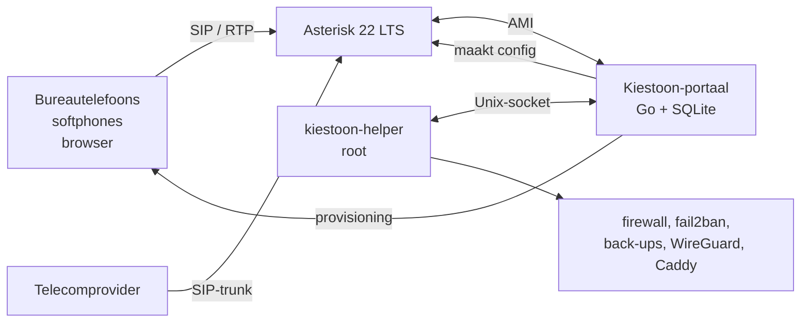

# Hoe Kiestoon werkt

Een paar ideeën komen op bijna elke pagina terug. Als je die kent, lees je de rest van de handleiding snel.

## De onderdelen

- **Asterisk 22 LTS** verwerkt de gesprekken. Je past de configuratie nooit zelf aan: Kiestoon maakt die uit de
  database en laadt alleen opnieuw wat veranderd is.
- **Het Kiestoon-portaal** is één programma met de webinterface, de REST-API, provisioning voor telefoons en de
  database (SQLite). Het draait als gebruiker zonder rootrechten.
- **kiestoon-helper** is een kleine root-dienst met een vaste lijst opdrachten: firewall toepassen, back-up of
  herstel draaien, WireGuard-tunnels opzetten, Caddy instellen. Het portaal vraagt; de helper controleert alles
  opnieuw.
- **kiestoon-updater** installeert updates die je vanuit het portaal start, na een back-up.

## Bestemmingen

Bijna alles wat een gesprek ontvangt, kan het doorsturen naar een **bestemming**. Dezelfde lijst wordt gebruikt
door inkomende routes, stappen in een keuzemenu, tijdcondities, de uitwijk van belgroepen en wachtrijen, en
follow-the-sun-regels:

| Bestemming | Gaat naar |
| --- | --- |
| Toestel | Eén persoon; al zijn apparaten gaan over |
| Voicemail | Direct naar iemands voicemailbox |
| Belgroep | Een team, allemaal tegelijk of één voor één |
| Wachtrij | Bellers wachten in de rij tot een medewerker vrij is |
| Keuzemenu (IVR) | "Toets 1 voor verkoop …" |
| Tijdconditie | Open, gesloten of feestdag, elk met een eigen bestemming |
| Vergaderruimte | Een vergadernummer |
| Faxbox | Ontvangt een fax en mailt hem als pdf |
| Extern nummer | Doorschakelen naar een mobiel of ander nummer (kost een uitgaand gesprek) |
| Gekoppeld systeem | Een toestel op een andere Kiestoon (zie [gekoppelde centrales](multi-site.md)) |
| Follow the sun | Het team dat nu aan het werk is, op tijdzone |
| Ophangen | Gesprek beëindigen |

Een gangbaar hoofdnummer: **inkomende route › tijdconditie › keuzemenu › belgroep of wachtrij**, met voicemail
als het gesloten is.

## Het nummerplan

Interne nummers zijn allemaal even lang: standaard 3 cijfers, of 4 of 5.

| Reeks (3 cijfers) | Gebruik |
| --- | --- |
| 200-599 | Toestellen |
| 600-699 | Belgroepen |
| 700-799 | Wachtrijen (70 en 71-79 zijn ook gesprekken parkeren) |
| 800-899 | Vergaderruimtes |
| `*`-codes | Voicemail en functies, zie [sneltoetscodes](feature-codes.md) |
| 112, 911 | Noodnummers, altijd toegestaan |

Je wijzigt de lengte onder **Instellingen › Nummerplan**. Bestaande toestellen worden hernummerd en
geprovisionde telefoons nemen hun nieuwe nummer vanzelf over.

## Rollen

| Rol | Mag |
| --- | --- |
| **Superbeheerder** | Alles, ook andere superbeheerders beheren |
| **Beheerder** | De telefooncentrale beheren. Logt altijd in met MFA |
| **Receptie** | Schakelbord, wallboard, gespreksgeschiedenis, opnames en fax; medewerkers aan- en afmelden; dag/nacht omzetten |
| **Gebruiker** | Het eigen toestel in het gebruikersportaal: doorschakelen, voicemail, collega's, gesprekken, toetsen |

Een gebruiker (met welke rol ook) die aan een toestel gekoppeld is, krijgt ook het menu **Mijn werkplek**: het
gebruikersportaal. Zie [Gebruikers, rollen en inloggen](users.md).

## Live status

Het portaal houdt een verbinding met Asterisk (AMI). Dashboard, schakelbord, wallboard, beschikbaarheid van
collega's en wachtrijen worden elke paar seconden bijgewerkt. Sneltoetscodes op een telefoon (bijvoorbeeld `*76`
voor niet storen) melden zich terug bij het portaal, dus portaal en telefoon tonen altijd hetzelfde.

## Productie en test

Elke versie verschijnt eerst op het **testkanaal** als release candidate (`v0.6.0-rc.12`) en gaat daarna naar
**productie** (`v0.6.0`). Elke installatie volgt één kanaal en kan wisselen in **Info & updates**. Zie
[Updates en kanalen](updates.md).
