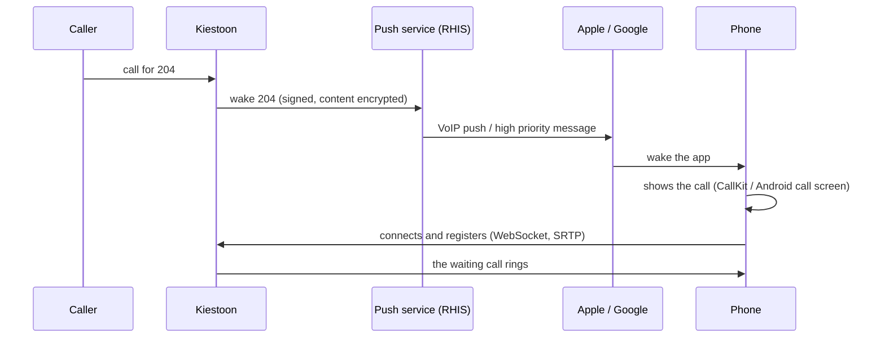

# Mobile app

The **Kiestoon app** for iPhone and Android takes an extension along on the road. It rings with the calls for
the extension, also when the app is closed and the phone is locked, and shows new voicemail as a notification
with the AI summary. It has the same screens as the [Windows softphone](softphone.md): colleagues with live
status, the phone book, queues, voicemail and call history.

!!! note "Availability"
    The apps are published by RHIS as **Kiestoon** in the App Store (iOS 16 and later) and Google Play (Android 10
    and later). Until the store release they are available as a test version (TestFlight and a Google Play test
    track); ask RHIS for an invitation.

## Switch it on

Open **Mobile app** in the System menu and turn on **Allow the mobile app**. Nothing else is needed: the
phone system talks to the push service of RHIS by itself.

| Setting | What it does |
| --- | --- |
| **Allow the mobile app** | Employees can link the app under **My devices**. Turning it off stops all wake-up notifications; linked phones stay in the list |
| **Push service address** | Leave it empty for `https://push.rhis.nl`. Only change it when you publish your own build of the app (see [Your own push service](#your-own-push-service)) |
| **Test connection** | Checks that this server reaches the push service and shows whether it delivers to iPhone, Android or both |

The table **Linked phones** shows every phone with its employee, when the app was last used and when the last
notification went out. **Unlink** removes a phone (for example a lost one); the app stops ringing at once.
A phone whose app was removed is unlinked by itself at the next notification.

## Link the app (employees)

1. Install **Kiestoon** from the App Store or Google Play.
2. In the portal, open **My devices** and press **Link mobile app**. A QR code appears.
3. Scan it with the camera of the phone. The app opens, links itself to your extension and asks to allow
   notifications and the microphone. Allow both: without notifications the app cannot ring when it is closed.

The code works once and for 10 minutes. On a phone without a camera, open the app, choose **Link with code**
and type the server address and the code. Linking uses the sign-in of the portal, so it works the same with a
password, MFA, a passkey or [single sign-on](users.md#single-sign-on): the app itself never sees a password.

Under **My devices** you see your linked phones. **Send test notification** checks that notifications arrive;
**Unlink** removes a phone.

## Using the app

The app has the screens of the [Windows softphone](softphone.md), with the menu as a tab bar at the bottom. An
incoming call shows on the phone's own call screen: on iPhone the CallKit screen (also on the lock screen and in
the car), on Android a full-screen call with **Answer** and **Decline**. During a call the phone keeps the
microphone and the audio running when you switch apps or lock the screen; on Android a notification shows the
call in progress with **Hang up**.

New voicemail shows as a notification. On Android it shows the caller and the AI summary; on iPhone it reads
**New voicemail**, open the app to see who called and the summary.

When **Allow the mobile app** is off, or the app was built without push (see [Build the app](#build-the-app)),
the app still works as a softphone while it is open, like the browser softphone.

## How a call reaches the phone

A phone in a pocket has no open connection to the phone system: iOS and Android close it to save the battery.
So the phone system wakes the app first:

The desk phone, the browser and the Windows softphone ring at the same moment, as always. The call waits up to
15 seconds for the phone to connect; on a normal 4G or Wi-Fi connection that takes one or two seconds. When the
caller hangs up first, or a colleague answers, the call screen on the phone goes away again.

Calls through ring groups and queues reach the app the same way. Intercom calls do not: the app never answers
by itself.

## Privacy and security

Apple and Google only deliver notifications for an app on behalf of its publisher, so a phone system cannot send
them directly. The **push service** of RHIS forwards them and is built so that it needs as little trust as
possible:

- **It stores nothing.** When a phone links, the push service turns the push token of the phone into a sealed
  handle that only the push service can open, and forgets it. Your phone system keeps the handle.
- **It cannot read the notifications.** Who is calling and the voicemail summary are encrypted with a key that
  only your phone system and the phone know. The push service only sees that a notification goes to a phone.
- **Every phone system has its own key** (shown on the settings page). A handle only works with the key of the
  phone system that made it, and every request is signed and works once, so nobody else can ring your phones.
- **It logs no numbers, tokens or contents.** The push service is open source (`cmd/kiestoon-push` in the
  repository).

Calls themselves never go through RHIS: the app connects straight to your phone system with encrypted audio
(WebRTC, DTLS-SRTP), the same way as the Windows softphone. For calls from outside the office the portal must be
reachable from the internet, see [Internet access and SSL](internet.md).

## Your own push service

Only the publisher of an app can send to it. When you build and publish the app yourself (under your own name in
the stores), run your own push service with your own Apple and Google keys:

1. Install the package `kiestoon-push_<version>_amd64.deb` (or `arm64`) from the
   [releases](https://github.com/rhisijmuiden/kiestoon/releases) on a small Debian server.
2. Apple: create a key with **Apple Push Notifications service** under developer.apple.com > Keys, and copy the
   `.p8` file to `/etc/kiestoon-push/apns.p8`. Google: create a service account key in the Firebase project and
   copy it to `/etc/kiestoon-push/fcm.json`. Give both `chgrp kiestoon-push` and `chmod 0640`.
3. Fill in `/etc/kiestoon-push/kiestoon-push.env` (key id, team id, bundle id of your app), remove
   `KIESTOON_PUSH_LOG_ONLY=1` and run `systemctl restart kiestoon-push`.
4. Put an HTTPS proxy in front, for example Caddy: `push.example.com { reverse_proxy 127.0.0.1:8095 }`.
5. On every phone system, enter `https://push.example.com` as **Push service address** and press **Test connection**.

The secret in `/var/lib/kiestoon-push/secret` seals the handles. Back it up: with a new secret every phone has to
open the app once to register again.

### Build the app

The source of the app is in the folder `mobile/` of the repository (Tauri 2, with a small native part in Kotlin
and Swift for push and the call screen). Every change is built by GitHub Actions (workflow **Mobile app**): a
debug APK for Android and a simulator build for iPhone. For your own store build you need:

- **Android:** a Firebase project with an Android app `nl.rhis.kiestoon` (or your own id). Put its
  `google-services.json` in `mobile/src-tauri/gen/android/app/`; without it the app builds without push. Sign the
  release APK or bundle with your upload key.
- **iPhone:** an Apple developer account, a Mac with Xcode, and the capabilities **Push Notifications** and
  **Background Modes** (Voice over IP, Audio, Remote notifications). Run `npx tauri ios init` and then
  `./ios-setup.sh` in `mobile/`, which adds the background modes, the microphone text and the push entitlement.

## Troubleshooting

| Problem | Solution |
| --- | --- |
| The app only rings when it is open | Notifications are not allowed for Kiestoon. Turn them on in the settings of the phone, open the app once, and use **Send test notification** |
| **Test connection** says the push service cannot be reached | The server needs outgoing HTTPS to `push.rhis.nl` (port 443). Check the firewall between the server and the internet |
| The call screen appears but the call does not connect | The phone cannot reach the portal over the internet. Check [Internet access](internet.md), or connect to the office Wi-Fi |
| A phone no longer shows in the list | The app was removed or reinstalled; Apple or Google then report the phone as gone and it is unlinked. Link it again |
