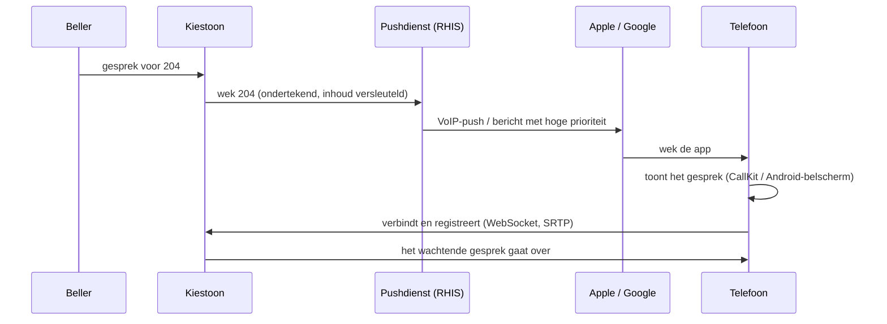

# Mobiele app

De **Kiestoon-app** voor iPhone en Android neemt een toestel mee onderweg. Hij gaat over met de gesprekken voor
het toestel, ook als de app gesloten is en de telefoon vergrendeld, en toont nieuwe voicemail als melding met de
AI-samenvatting. Hij heeft dezelfde schermen als de [Windows-softphone](softphone.md): collega's met live status,
het telefoonboek, wachtrijen, voicemail en gespreksgeschiedenis.

!!! note "Beschikbaarheid"
    De apps worden door RHIS uitgebracht als **Kiestoon** in de App Store (iOS 16 en nieuwer) en Google Play
    (Android 10 en nieuwer). Tot de release in de stores zijn ze beschikbaar als testversie (TestFlight en een
    testtrack van Google Play); vraag RHIS om een uitnodiging.

## Aanzetten

Open **Mobiele app** in het menu Systeem en zet **Mobiele app toestaan** aan. Meer is niet nodig: de
telefooncentrale praat zelf met de pushdienst van RHIS.

| Instelling | Wat het doet |
| --- | --- |
| **Mobiele app toestaan** | Medewerkers kunnen de app koppelen onder **Mijn apparaten**. Uitzetten stopt alle wekmeldingen; gekoppelde telefoons blijven in de lijst |
| **Adres van de pushdienst** | Laat leeg voor `https://push.rhis.nl`. Wijzig dit alleen als je een eigen versie van de app uitbrengt (zie [Eigen pushdienst](#eigen-pushdienst)) |
| **Verbinding testen** | Controleert of deze server de pushdienst bereikt en of die naar iPhone, Android of beide bezorgt |

De tabel **Gekoppelde telefoons** toont elke telefoon met de medewerker, wanneer de app voor het laatst gebruikt
is en wanneer de laatste melding verstuurd is. **Ontkoppelen** verwijdert een telefoon (bijvoorbeeld een
verloren exemplaar); de app gaat dan meteen niet meer over. Een telefoon waarvan de app verwijderd is, wordt bij
de volgende melding vanzelf ontkoppeld.

## De app koppelen (medewerkers)

1. Installeer **Kiestoon** uit de App Store of Google Play.
2. Open in het portaal **Mijn apparaten** en kies **Mobiele app koppelen**. Er verschijnt een QR-code.
3. Scan hem met de camera van de telefoon. De app opent, koppelt zich aan je toestel en vraagt toestemming voor
   meldingen en de microfoon. Sta beide toe: zonder meldingen kan de app niet overgaan als hij gesloten is.

De code werkt één keer en 10 minuten lang. Op een telefoon zonder camera open je de app, kies je **Koppelen met
code** en typ je het serveradres en de code. Koppelen gebruikt de aanmelding van het portaal, dus het werkt
hetzelfde met een wachtwoord, MFA, een passkey of [single sign-on](users.md#single-sign-on): de app zelf ziet
nooit een wachtwoord.

Onder **Mijn apparaten** zie je je gekoppelde telefoons. **Testmelding sturen** controleert of meldingen
aankomen; **Ontkoppelen** verwijdert een telefoon.

## Hoe een gesprek de telefoon bereikt

Een telefoon in je zak heeft geen open verbinding met de telefooncentrale: iOS en Android sluiten die om de
batterij te sparen. Daarom wekt de telefooncentrale eerst de app:

Het bureautoestel, de browser en de Windows-softphone gaan tegelijk over, zoals altijd. Het gesprek wacht
maximaal 15 seconden tot de telefoon verbonden is; op een gewone 4G- of wifiverbinding duurt dat een à twee
seconden. Hangt de beller eerder op, of neemt een collega op, dan verdwijnt het belscherm weer van de telefoon.

Gesprekken via belgroepen en wachtrijen bereiken de app op dezelfde manier. Intercomgesprekken niet: de app neemt
nooit vanzelf op.

## Privacy en beveiliging

Apple en Google bezorgen meldingen voor een app alleen namens de uitgever, dus een telefooncentrale kan ze niet
zelf versturen. De **pushdienst** van RHIS stuurt ze door en is zo gebouwd dat hij zo min mogelijk vertrouwen
nodig heeft:

- **Hij bewaart niets.** Als een telefoon koppelt, maakt de pushdienst van het pushtoken van de telefoon een
  verzegelde handle die alleen de pushdienst kan openen, en vergeet hij het token. Jouw telefooncentrale bewaart
  de handle.
- **Hij kan de meldingen niet lezen.** Wie er belt en de samenvatting van voicemail worden versleuteld met een
  sleutel die alleen jouw telefooncentrale en de telefoon kennen. De pushdienst ziet alleen dát er een melding
  naar een telefoon gaat.
- **Elke telefooncentrale heeft een eigen sleutel** (zichtbaar op de instellingenpagina). Een handle werkt alleen
  met de sleutel van de telefooncentrale die hem maakte, en elk verzoek is ondertekend en werkt één keer, dus
  niemand anders kan jouw telefoons laten overgaan.
- **Hij logt geen nummers, tokens of inhoud.** De pushdienst is open source (`cmd/kiestoon-push` in de
  repository).

De gesprekken zelf gaan nooit via RHIS: de app verbindt rechtstreeks met jouw telefooncentrale met versleuteld
geluid (WebRTC, DTLS-SRTP), net als de Windows-softphone. Voor gesprekken buiten kantoor moet het portaal vanaf
internet bereikbaar zijn, zie [Internettoegang en SSL](internet.md).

## Eigen pushdienst

Alleen de uitgever van een app kan er meldingen naar sturen. Breng je de app zelf uit (onder je eigen naam in de
stores), draai dan een eigen pushdienst met je eigen sleutels van Apple en Google:

1. Installeer het pakket `kiestoon-push_<versie>_amd64.deb` (of `arm64`) van de
   [releases](https://github.com/rhisijmuiden/kiestoon/releases) op een kleine Debian-server.
2. Apple: maak een sleutel met **Apple Push Notifications service** onder developer.apple.com > Keys en kopieer
   het `.p8`-bestand naar `/etc/kiestoon-push/apns.p8`. Google: maak een sleutel voor een serviceaccount in het
   Firebase-project en kopieer die naar `/etc/kiestoon-push/fcm.json`. Geef beide `chgrp kiestoon-push` en
   `chmod 0640`.
3. Vul `/etc/kiestoon-push/kiestoon-push.env` in (key id, team id, bundle id van je app), haal
   `KIESTOON_PUSH_LOG_ONLY=1` weg en voer `systemctl restart kiestoon-push` uit.
4. Zet er een HTTPS-proxy voor, bijvoorbeeld Caddy: `push.example.com { reverse_proxy 127.0.0.1:8095 }`.
5. Vul op elke telefooncentrale `https://push.example.com` in als **Adres van de pushdienst** en kies
   **Verbinding testen**.

Het geheim in `/var/lib/kiestoon-push/secret` verzegelt de handles. Maak er een back-up van: met een nieuw geheim
moet elke telefoon de app één keer openen om opnieuw te registreren.

## Problemen oplossen

| Probleem | Oplossing |
| --- | --- |
| De app gaat alleen over als hij open is | Meldingen staan uit voor Kiestoon. Zet ze aan in de instellingen van de telefoon, open de app één keer en gebruik **Testmelding sturen** |
| **Verbinding testen** meldt dat de pushdienst niet bereikbaar is | De server heeft uitgaand HTTPS nodig naar `push.rhis.nl` (poort 443). Controleer de firewall tussen de server en internet |
| Het belscherm verschijnt maar het gesprek komt niet tot stand | De telefoon bereikt het portaal niet via internet. Controleer [Internettoegang](internet.md), of verbind met de wifi van kantoor |
| Een telefoon staat niet meer in de lijst | De app is verwijderd of opnieuw geïnstalleerd; Apple of Google melden de telefoon dan als verdwenen en hij wordt ontkoppeld. Koppel hem opnieuw |
